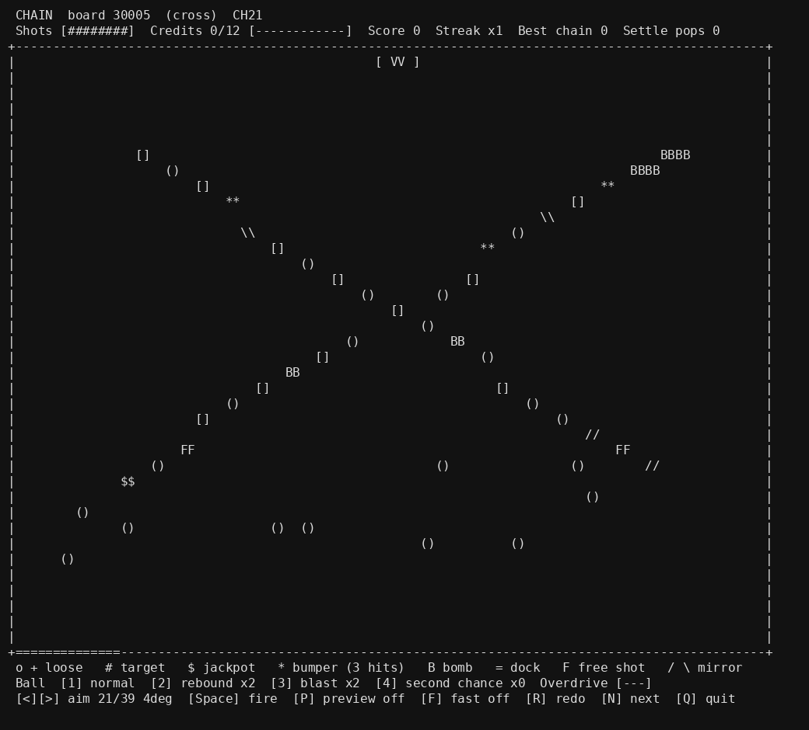
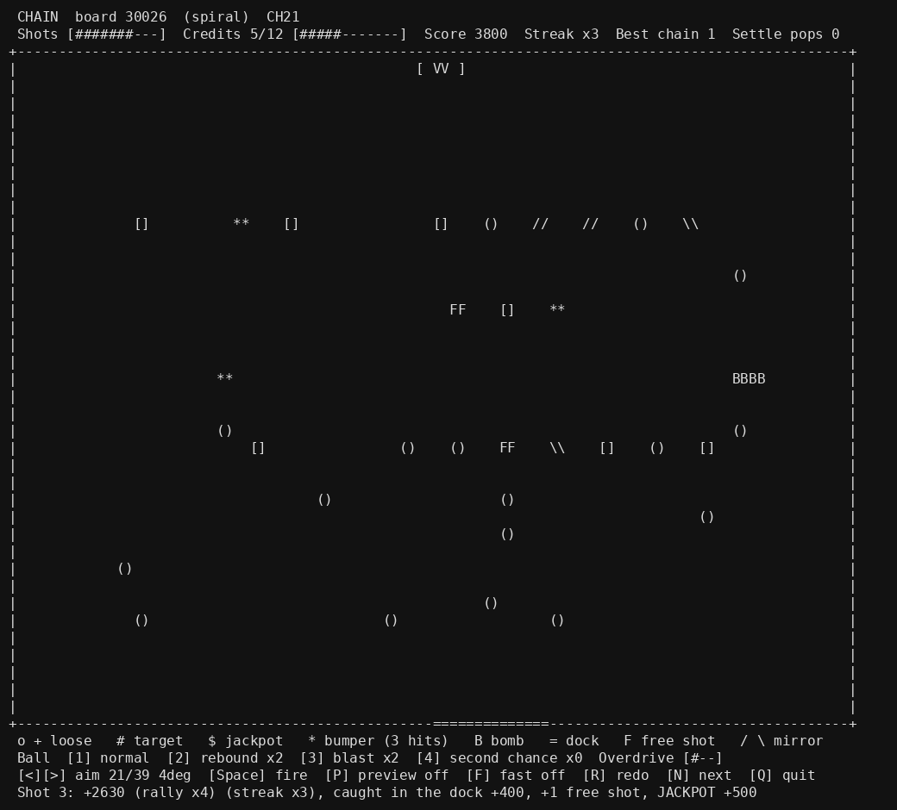

# CHAIN

A terminal game in Python. Aim a cannon, fire a ball into a board of pegs and targets, and clear every board in a run. Python 3 standard library only.

**Status: work in progress.** Version CH25.  The board is half-width with every cell two columns wide (50 cells across), so sprites are bigger in the same terminal size, CH17 added an Overdrive meter, and CH18 added three new board shapes (spiral, funnel, stairs), CH19 marks one target on each board as a jackpot worth +500 extra, CH20 adds three more board shapes (cross, zigzag, bowl), and CH21 moves the jackpot to the target that the fewest opening aims can strike (the hard one, still only +500 and never required). CH23 adds two more board shapes (pinwheel, columns) and Marathon mode: press M on the title screen for an endless ladder of boards - the quota rises every two boards (8, 8, 9, 9, 10, 10, 11, 11, then all 12 targets) and the shot limit tightens deeper in (8 shots, then 7, then 6). The first board you fail ends the marathon, and your best marathon (boards cleared, then score) is saved to ChainMarathon.txt. CH21 board codes and CH21R run codes still replay to exactly the boards they had, because the code prefix picks the board generator (checked by VersionTest25.py); CH23 and CH23R codes use the thirteen-shape set, CH23M codes replay their marathon. The title screen is a real menu (premise text now opens the help page): arrow keys (or the shown letters) pick from start a run, marathon, daily run, how to play and quit, and your best run and marathon show under it. Board clears, run complete and marathon over come up as framed panels, and the help page shows the board pieces. CH25 adds two more board shapes (hourglass, towers) on top of the tuned set; CH23, CH23R and CH23M codes keep resolving through the frozen thirteen-shape set and CH24, CH24R and CH24M codes through the frozen tuned set, each pinned by digest in VersionTest25.py, and only codes from CH22, CH20 and earlier no longer work. CH24 tunes every shape into a narrow difficulty band (one-shot-lookahead bot clear rates 62.2% to 68.5%, a 6.2-point spread, measured by LayoutMeasure18.py over seeds 30001..43000, about 1000 boards per shape; the baseline CH23 spread on the same tool and seeds was 29.1), drops the scatter fallback for good, and spreads diamonds and rings targets by construction; CH24, CH24R and CH24M codes use it. Codes from CH22, CH20 and earlier no longer work. Everything below is builder-reported from my own automated tests. Not tested: a real Windows console, a person playing a full run, colour by a human eye.

## Run it

- Graphical web UI (new, any platform with a browser): `python3 ChainWeb.py` - starts a localhost server and opens the game in your browser with drawn sprites, mouse aiming and animated shots. It listens on 127.0.0.1 only and the printed link carries a per-launch token, so nothing else on the machine (or the network) can drive it. Same engine, same rules, same run codes, same records files. Linux is the primary platform and the web UI is developed and tested natively on Linux/Ubuntu; on Windows double-click `PlayWeb.bat` instead. Browser launch under Wine is untested - if no browser opens, copy the printed link into any browser on the same machine.
- Terminal (original): `python3 ChainDemo.py --menu`. Linux is the primary platform: the game and its test suite are developed and run natively on Linux/Ubuntu, and platform-specific modules (msvcrt, termios) are imported only behind OS guards.
- Windows terminal: keep `ChainDemo.py`, `Play.bat` and `PlayText.bat` in one folder and double-click `Play.bat`. Windows is untested.

The terminal needs at least 104 columns by 49 rows. `HowToRun.txt` has the keys and rules and the display options (`--mono`, `NO_COLOR`, `--ascii`, `--delay`, `--text`).

## What a run is

Three boards. Earn the credit quota on each (9, 10, 10; one credit per target cleared) within 8 base shots (dock and heart bonus shots can add more). A dock sweeps the floor: land the ball in it for a free shot and +400 (first 2 catches per board). Overdrive: every shot with a rally of x3 or more fills one segment of a three-segment meter; the third segment gives one extra Rebound ball for that board only (once per board, not carried to the next). Press D on the menu for the daily run. The run code printed on exit replays the whole run; marathon codes (CH25M-..., and old CH24M- and CH23M-... codes) replay a marathon the same way. Codes from CH22, CH20 and earlier no longer work.

The picture is the game's own frame (a cross board, plain text mode, jackpot shown as $$) rendered to an image without colour, not a live terminal capture.

The second picture is a mid-run frame from the CH21 engine (a spiral board after the third shot of a test-bot run: the jackpot has just been collected, so its $$ is gone and the shot message ends with JACKPOT +500). It is drawn the same way, from the game's own frame without colour, and is not a live terminal capture.

## Tests

The `*15` scripts (`ChainTest15.py`, `DockTest15.py`, `KeyTest15.py` and the rest) assert and exit non-zero on failure. They are my own tests, so treat results as builder-reported. `PtyDrive15.py` plays whole runs through a real pseudo-terminal.

`TagTest16.py` checks the floating score tag drawing, and `OverdriveTest17.py` checks the Overdrive meter (fills, one bonus ball per board, replay and resume, HUD width).

`JackpotMeasure21.py CH20_FOLDER` compares CH21 with a CH20 copy on the same seeds per shape (clear results and shot counts are identical because only the jackpot target and score change).
`BalanceCH17.py` prints reproducible clear-rate numbers for seeds 30001..30300 (`python3 BalanceCH17.py [first_seed] [count]`). The policy is the bot from `ChainTest15.py`, plus a random-aim baseline. It measures how often a simple bot and random aim clear boards. It does not measure human difficulty.

`MessageFitTest17.py` checks that the shot message always fits the screen with its score and reward text intact, and that the Overdrive meter flash only changes colour.

`RecapTest17.py` checks the board-end recap line ("N targets left to clear", or the cleared-in summary, each ending with whether the jackpot was collected) and the per-board summary printed after the run code, against an independent recount.

`ColorEnvTest17.py` checks that the NO_COLOR environment variable turns colour off, and that the "window too small" size matches the real board.

`BannerTest24.py` checks the title menu (entries, selector, arrow-key navigation, records from the best files), the framed result panels and the help-page legend in mono, ascii and colour modes.

`VersionTest25.py` checks that CH21 and CH21R codes still resolve to the same boards as the published CH22 engine (digest over 600 seeds), that CH23, CH23R and CH23M codes still resolve to their pinned thirteen-shape generator and CH24, CH24R and CH24M codes to their pinned tuned generator (the same digests as VersionTest24), that CH25 codes use the fifteen-shape tuned generator, that retired and unknown prefixes are rejected, that the scatter fallback is gone, that every shape carries its tuned target count, and that hourglass and towers boards are distinct, in-bounds, jackpot-carrying and opening-reachable.

`RestartTest23.py` drives the real game with --resume on a CH21R, a CH23R, a CH24R and a CH25R run, presses r, and checks the restarted board, title bar and printed run codes keep that run's version (a restart used to rebuild a CH21R run on the CH23 boards).

`MarathonTest23.py` checks Marathon mode: the pinned quota and shot curve, marathon playthroughs with marathon code round-trips through resume, mid-marathon resume keeping the mode and limits, restart keeping marathon mode, both parsers rejecting each other's prefix, and the marathon best file.

`LayoutTest18.py` checks the six newer board shapes (spiral, funnel, stairs, cross, zigzag, bowl) over 1200 seeds: they never fall back to scatter, always have 12 targets, keep target spacing, give an opening shot a reasonable reach, and are cleared by the test bot about as often as the older shapes. It does not measure how fun they are. `LayoutMeasure18.py` prints the per-shape table.

`JackpotTest19.py` checks the jackpot target: one per board, always a real target, the one that the fewest of the 39 opening aims can strike (independent recount, ties picked by seed), +500 paid once and only on the shot that clears it, replay agreement, and the drawing.
